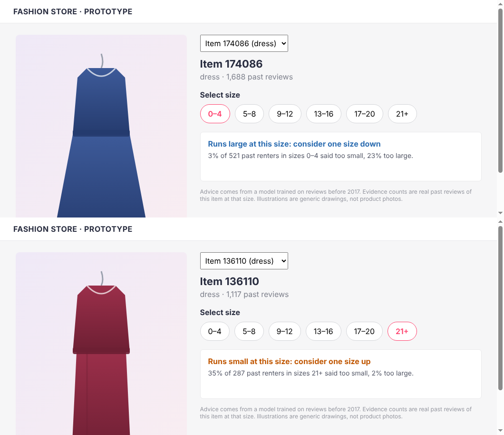

# Fashion Fit Advisor: Root Cause, Size-Aware Advice & A/B Design

Online fashion's costliest problem is the wrong size: it turns into returns,
exchanges and low ratings. This project takes **192,544 real Rent the Runway
reviews** (105,571 customers, 5,850 items, 2010–2018), finds where fit problems come
from, builds and tests a size-advice feature for the product page, and writes up
the product case.

- **Root cause:** [`src/root_cause.py`](src/root_cause.py) → [`results/root_cause.json`](results/root_cause.json)
- **Size-advice model, tested on later unseen reviews:** [`src/advisor.py`](src/advisor.py) → [`results/advisor.json`](results/advisor.json)
- **Clickable prototype:** [live demo](https://adityaaviero47.github.io/fashion-fit-advisor/prototype/) · source [`prototype/index.html`](prototype/index.html)
- **Product requirements doc** with KPIs, experiment and rollout: [`PRD.md`](PRD.md)



## Key findings

1. **26.2%** of orders did not fit (13.4% too small, 12.8% too large).
2. Misfits cost ratings: orders that didn't fit were rated 6/10 or lower
   **3.5–3.9x** as often (15.5–17.2% vs 4.4%).
3. **The direction flips with size.** Sizes 0–4 mostly come up too large
   (17.9% vs 7.8% too small); sizes 17–20 mostly too small (18.3% vs 10.5%).
   One "runs small" label per item can't be right for everyone.
4. **46%** of items with 30+ reviews clearly run small or large, so the signal is there.
5. A customer who had a fit problem is more likely to hit another (31.7% vs 26.1%).
6. 70% of fit complaints say so in the review text: a usable signal where no fit
   flag exists.

## The prototype and how well it works

When a shopper picks a size, the page says whether that size runs small, large or
true, with the real review counts behind it.

**Test setup:** a gradient-boosting model on the customer's chosen size, body data,
past fit history, and the item's fit history at that size. Trained on reviews before
2017; tested on the **69,126 reviews from 2017 on**. Item statistics in the test
come only from the training period; training rows only see earlier reviews.

| | Size-blind label ("runs small") | Size-aware model |
|---|---:|---:|
| AUC, too small | 0.69 | **0.75** |
| AUC, too large | 0.69 | **0.75** |
| "Size up" advice right | 36.0% | **41.0%** |
| "Size down" advice right | 29.7% | **36.8%** |
| Fit problems reached, same 23% of orders | 28.3% | **33.3%** |
| Advice pointing the wrong way | 2.1–3.7% | 2.4–3.4% |

At the same coverage the size-aware model reaches **18% more fit problems**, with
about the same wrong-direction rate, and it can advise on brand-new items (8.8% of
its advice), which a label built from an item's own reviews can't.

The riskiest 20% of orders by the model hold **34%** of all fit problems (45.6% of
them misfit vs 27.1% overall).

## Tagging fit from review text (classic NLP and GenAI)

Most marketplaces collect free-text reviews and return comments, not a
"too small / fit / too large" field. So the question is: can the text alone tell
us the fit, and *why*?

- **Baseline** ([`src/text_tagger.py`](src/text_tagger.py)): TF-IDF + logistic
  regression trained on pre-2017 reviews. On all 69,126 later reviews: macro-F1
  **0.68**. On a balanced sample of 300 (100 per class): **73%** accuracy, macro-F1 0.73.
- **GenAI** ([`src/llm_tagger.py`](src/llm_tagger.py)): Gemini reads the same 300
  reviews (20 per call) and returns the fit **and the body area behind it** (bust,
  waist, hips, length, shoulders, arms). It is scored against each customer's own
  label, which it never sees. Results: [`results/llm_tagger.json`](results/llm_tagger.json).

| Same 300 later reviews (100 per class) | Accuracy | Macro-F1 |
|---|---:|---:|
| TF-IDF model trained on 123,418 labelled reviews | 73.0% | 0.73 |
| **Gemini (`gemini-flash-lite-latest`), zero training data, prompt only** | **78.7%** | **0.79** |

- Gemini beat a model trained on 123K labels without seeing one, which matters
  because most marketplaces' reviews and return comments have no fit labels at all.
- It confused "too small" with "too large" only 7 times in 300 (2.3%); most of its
  errors were calling a misfit "fit".
- It named a body area for 59% of the too-small reviews it tagged correctly and 40%
  of the too-large ones. The bust was the most common (30 of 76 named areas).

The body area is what a catalogue team needs: "runs small" says *that* a size
chart is wrong, while "too tight in the bust" says *where*.

## A/B test design

- 50/50 split by customer.
- To detect a 1-point drop in fit-issue rate (27.1% → 26.1%) with 80% power:
  **30,630 orders per arm**. A 2-point drop needs 7,564.
- Guardrails: add-to-cart conversion, cart abandonment, average order value.
- Details: [`PRD.md`](PRD.md), [`results/experiment.json`](results/experiment.json).

## Limitations

- Rent the Runway is a US rental site; shoppers and sizes differ in Indian fashion
  e-commerce. The method transfers, the numbers have to be re-measured.
- Reviews are a proxy for returns: not every misfit is returned, and not every
  return is about fit.
- Offline results only. Whether shoppers follow the advice, and whether it lowers
  returns, needs the A/B test.
- The GenAI tagger is scored on 300 reviews: enough to compare with the baseline, not a production estimate.

## Run it

```bash
pip install -r requirements.txt
bash get_data.sh                  # downloads renttherunway_final_data.json.gz into data/
cd src
python root_cause.py              # findings      -> results/root_cause.json
python advisor.py                 # model + test  -> results/advisor.json, widget_examples.json
python experiment.py              # A/B sizing    -> results/experiment.json
python build_prototype.py         # prototype/index.html (open in any browser)
python text_tagger.py             # text baseline -> results/text_tagger.json, llm_eval_sample.csv
GEMINI_API_KEY=... python llm_tagger.py   # GenAI tagger -> results/llm_tagger.json
```

## Data

Rent the Runway fit feedback, collected by Rishabh Misra, Mengting Wan and Julian
McAuley, *"Decomposing fit semantics for product size recommendation in metric
spaces"*, RecSys 2018. Public research dataset from the
[UCSD McAuley Lab](https://cseweb.ucsd.edu/~jmcauley/datasets.html). It is not
committed to this repo; `get_data.sh` downloads it.
